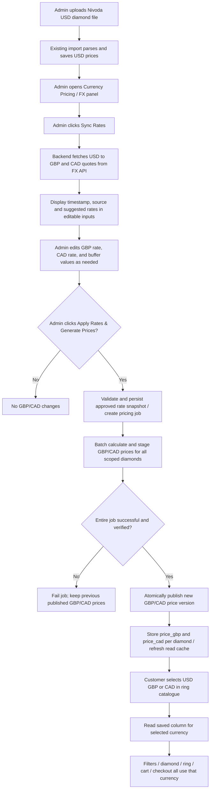

# Nivoda Diamond Catalogue — Manual FX Sync & Stored Multi-Currency Pricing

**Status:** FINAL implementation specification for Claude Code / development team  
**Version:** 2.0 — supersedes the prior automated FX sync specification  
**Scope:** Nivoda diamond imports, admin exchange-rate approval, persisted USD/GBP/CAD catalogue prices, currency-specific product display, cart and checkout  
**Primary rule:** **Nothing related to FX rates or currency-price generation runs automatically after upload. The administrator explicitly initiates `Sync Rates`, reviews/edits the values, and explicitly clicks `Apply Rates & Generate Prices`.**

---

## 1. What we actually want

Our catalogue may contain **1,000,000+ diamonds** imported from Nivoda. The Nivoda import provides prices in **USD**. We want **three persisted, independently queryable price fields on the same diamond record**:

- `price_usd` — existing USD selling price (preserve its established pricing/markup logic).
- `price_gbp` — GBP selling price generated and saved **only on administrator approval**.
- `price_cad` — CAD selling price generated and saved **only on administrator approval**.

The administrator uploads/imports a Nivoda file, opens the admin FX panel, clicks **Sync Rates** to fetch current USD→GBP and USD→CAD market rates from the configured API, reviews or adjusts **editable GBP rate, CAD rate and buffer fields**, then clicks **Apply Rates & Generate Prices**. The system calculates GBP/CAD for every diamond in the relevant catalogue/import scope, stores the results in the two DB columns, and publishes the completed prices.

A shopper chooses **USD, GBP or CAD** in the diamond catalogue/ring configuration. All displayed diamond prices, sorting/filtering, selection, ring totals, cart, payment and checkout must use the **stored column for that selected currency**, not an FX lookup at browsing or checkout time.

### Non-negotiable requirements

1. **No cron job, scheduled FX update, automatic FX fetch at upload, auto-approval, or silent price repricing.** Uploading alone must not fetch/apply rates.
2. `Sync Rates` **fetches quotes for review only**. It **does not** recalculate, persist, or publish new diamond GBP/CAD prices.
3. Admin rate and buffer inputs are **editable**; admins may type values instead of using the fetched quotes.
4. `Apply` must require explicit authenticated admin confirmation and use the **currently visible approved input values**.
5. USD, GBP and CAD prices must be available as persisted catalogue fields; do not calculate shopper-facing GBP/CAD with a live API or per-request FX conversion.
6. Handle 1,000,000+ diamonds efficiently, without HTTP request timeouts, a million in-memory objects, or partially published rates.
7. **Currency at checkout must be the selected currency in the payment-provider charge itself**, not merely a different currency symbol on a USD charge.
8. All prices, rates, and totals must be calculated using exact decimal arithmetic, with explicit currency rounding rules; no binary floating-point for money.
9. Protect existing USD markup/price checker/business logic: **do not apply the markup twice**.
10. Inspect the existing repository/schema/routes/import flow/checkout provider before implementing; adapt names and code to the actual stack. Do not replace the existing diamond import or redesign unrelated architecture.

---

## 2. End-to-end user and admin flow



**Important:** Existing USD prices can be updated on file upload according to the existing import behaviour. Do not unexpectedly expose newly imported diamonds with missing GBP/CAD prices. Use clear `pending_currency_pricing` availability and only publish an import/batch for GBP/CAD once the admin's FX application succeeds. If the current system cannot safely support per-currency visibility, stage the new import until approval and publish the catalogue as a coordinated revision.

### Example of the intended user interface

```text
ADMIN > Diamond Catalogue > Currency Pricing

Last uploaded file: nivoda_2026-10-28.csv
Diamond records: 1,000,000
Published pricing version: FX-00017

[ Sync Rates ]              <- fetch rates only, no diamond price update

Currency       FX market rate (1 USD = ?)       Editable rate
USD -> GBP     0.7450                          [ 0.7450 ]
USD -> CAD     1.4015                          [ 1.4015 ]
FX source: {provider}     Fetched: {timestamp}

GBP buffer (%)                                [ 2.00 ]
CAD buffer (%)                                [ 2.00 ]

Preview effective GBP rate: 0.759900
Preview effective CAD rate: 1.429530

Example USD selling price: $1,350.00
GBP preview (before configured rounding): £1,025.865
CAD preview (before configured rounding): C$1,929.8655

[ Apply Rates & Generate Prices ]
  -> Confirmation: Apply these rates to 1,000,000 diamonds?
  -> Queue background processing job (triggered by this click, NOT scheduled)
  -> Show processing status / progress / errors
  -> Show success only after full verification and publication
```

The rate input may auto-populate from `Sync Rates`, but **never auto-apply**. Allow manual entry when the FX API is unavailable. Label an overridden rate as **Manual**; record who changed it and why.

---

## 3. Source of truth & pricing formula

### 3.1 USD price source

Inspect the existing application and determine the final USD price actually sold to customers:

- If Nivoda supplies raw cost and the system uses markup/price checks, keep the existing pipeline and use the **final USD catalogue selling price** as `price_usd`.
- If `price_usd` is already the customer-facing USD selling price, **do not add markup again**.
- Maintain Nivoda cost, USD selling price and price-check output as separate fields if already present. Do not overwrite cost with selling price.
- Existing inventory, availability, diamond IDs, certificates, search indexes and other metadata remain intact.

### 3.2 Currency formula

Admin supplies values expressed as **local currency units per 1 USD**. Examples: `1 USD = 0.7450 GBP`, `1 USD = 1.4015 CAD`.

```text
GBP effective rate = approved_usd_to_gbp * (1 + gbp_buffer_percent / 100)
CAD effective rate = approved_usd_to_cad * (1 + cad_buffer_percent / 100)

price_gbp = round_currency(price_usd * GBP effective rate, GBP rounding policy)
price_cad = round_currency(price_usd * CAD effective rate, CAD rounding policy)

price_usd = existing final USD selling price (no FX buffer)
```

Example when `price_usd = 1350.00`, GBP market rate = `0.7450`, CAD market rate = `1.4015`, and both buffers = `2%`:

| Field | Value |
|---|---:|
| USD final selling price | $1,350.00 |
| Effective GBP rate | 0.759900 |
| GBP unrounded price | £1,025.86500 |
| GBP price, rounded to nearest whole pound | **£1,026** |
| Effective CAD rate | 1.429530 |
| CAD unrounded price | C$1,929.86550 |
| CAD price, rounded to nearest whole dollar | **C$1,930** |

**Rounding is configurable per currency.** Recommended default for MVP: round to 2 decimal places (`£1,025.87`, `C$1,929.87`) using an explicitly selected decimal rule (e.g., half-up), and store as DECIMAL(18,2), or integer minor units. If the business decides nearest whole unit or price ending in `9`, implement that as a deliberate separate policy and test it. Never mix display rounding and checkout charging rules.

### 3.3 Rate precision

- Use `DECIMAL(20,10)` (or a suitable equivalent) for exchange rates; keep the raw approved rate, percentage buffer, and effective rate for each currency.
- Reject zero, negative, nonfinite, out-of-range or incorrectly quoted input values.
- Make rate direction explicit: USD base → GBP/CAD quote. Do **not** accidentally invert a GBP→USD quote.
- Support different GBP/CAD buffers, even when both initially default to 2%.

---

## 4. Database design — adapt to existing tables

**Do not create duplicate diamond entities if one already exists.** Add price columns to the existing catalogue table. Indicative SQL (PostgreSQL syntax; translate to actual ORM/database):

```sql
ALTER TABLE diamonds
  ADD COLUMN IF NOT EXISTS price_gbp NUMERIC(18,2),
  ADD COLUMN IF NOT EXISTS price_cad NUMERIC(18,2),
  ADD COLUMN IF NOT EXISTS fx_price_version_id BIGINT;
-- Existing USD selling-price column is retained or mapped to price_usd.
```

When feasible, track USD price version/import version separately so a GBP/CAD row can be verified as derived from the matching USD price. For per-currency publishing under heavy concurrent traffic, **a versioned staging and atomic publication strategy is mandatory** (see section 7): updating `price_gbp` and `price_cad` directly in million-row batches while shoppers query them would reveal mixed old/new rates. Choose an appropriate implementation for the actual DB/architecture.

### 4.1 Approved FX snapshot

Create an `fx_rate_batches` / `currency_pricing_versions` table containing:

| Field | Purpose |
|---|---|
| `id` | Immutable approved rate version ID |
| `import_id` / `catalogue_revision_id` | Target scope; distinguish uploads |
| `usd_to_gbp_market_rate` | Approved editable GBP rate |
| `usd_to_cad_market_rate` | Approved editable CAD rate |
| `gbp_buffer_pct`, `cad_buffer_pct` | Approved buffer inputs |
| `usd_to_gbp_effective_rate`, `usd_to_cad_effective_rate` | Calculated and persisted effective rates |
| `rate_source` | API provider or manual |
| `api_fetched_at` | Quote timestamp if known |
| `approved_by`, `approved_at` | Admin identity and approval time |
| `status` | `pending`, `processing`, `staged`, `published`, `failed`, `cancelled` |
| `rounding_policy` | Versioned pricing rule |
| `expected_count`, `processed_count`, `failed_count` | Tracking/reconciliation |
| `error_summary` | Failure reporting |
| `published_at` | Actual activation time |

Also create a job tracking table if the application does not already have an equivalent. Record audit history for manual edits and FX approvals. Keep checkout snapshots immutable even after price versions change.

### 4.2 Pricing data staging

Recommended logical design:

```text
currency_pricing_stage / versioned_diamond_prices
  pricing_version_id
  diamond_id
  source_usd_price
  source_usd_price_revision
  price_gbp
  price_cad
  calculation_status
  PRIMARY KEY (pricing_version_id, diamond_id)
```

Then use a small **active/published version pointer** (`active_currency_pricing_version`) to atomically switch readers after full success. The live catalogue still exposes logically named `price_usd`, `price_gbp`, `price_cad` for the same diamond through a DB view, joined pricing version, denormalized read model or repository abstraction. If physical columns on the diamond table are required, materialize them in a safe publication/swap process and guarantee no partially updated customer-facing catalogue. Discuss the trade-off in code comments and the implementation notes.

**Requirement priority:** 3 persisted currency prices per diamond, fast indexed querying, and atomic publication take precedence over a particular internal staging-table design.

---

## 5. Backend endpoints / actions (illustrative, align with existing conventions)

| Operation | Suggested endpoint | Behavior |
|---|---|---|
| Fetch rates | `POST /admin/currency-pricing/sync-rates` | Calls FX API on demand; returns suggested USD→GBP/CAD rates + source/timestamp, **no prices changed** |
| Read configuration | `GET /admin/currency-pricing` | Returns last fetched/approved/published rates, active version, job status |
| Preview | `POST /admin/currency-pricing/preview` | Validates editable inputs and returns effective rates / representative price examples, **no changes** |
| Apply | `POST /admin/currency-pricing/apply` | Authenticated, explicitly confirmed action; validates approved GBP/CAD rates/buffers; creates immutable version + job; return job ID |
| Job progress | `GET /admin/currency-pricing/jobs/:id` | Progress, total, errors, status and publication result |
| Catalogue search | Existing catalogue endpoint | Includes selected currency price, filtering/sorting on the **correct stored currency** |
| Diamond details | Existing diamond endpoint | Exposes all 3 saved prices as authorized/needed; selected currency determines visible price |
| Checkout | Existing checkout endpoint | Server resolves selected currency and validated stored prices; payment provider receives matching currency + exact amount |

Example FX fetch response:

```json
{
  "base": "USD",
  "quotes": {"GBP": "0.7450", "CAD": "1.4015"},
  "source": "configured-fx-provider",
  "fetched_at": "2026-10-28T05:00:00Z",
  "status": "suggested_only"
}
```

Example apply request:

```json
{
  "catalogue_revision_id": "CURRENT_IMPORT_OR_CATALOGUE_REVISION",
  "usd_to_gbp": "0.7450",
  "usd_to_cad": "1.4015",
  "gbp_buffer_percent": "2.00",
  "cad_buffer_percent": "2.00",
  "rounding_policy": "minor_unit_half_up",
  "confirmation": true,
  "idempotency_key": "unique-admin-generated-action-key"
}
```

The API must not accept a USD selling price supplied by the browser as authoritative, and it must never trust client-submitted cart totals for payment.

---

## 6. FX API integration and admin controls

1. Add provider-specific API credentials to **server-side environment variables/secret manager**. Never expose the API key to browser code, response payloads or logs.
2. Implement an FX provider adapter that fetches **both USD→GBP and USD→CAD** in one request if supported; otherwise use appropriate provider calls.
3. Verify HTTP status, response format, quote base, freshness metadata, numeric precision, and that both requested quote currencies exist.
4. Clicking **Sync Rates** makes the call **at that moment only**. It fills the admin's editable text fields. It does not start calculation.
5. Admin may override either rate, and enter/change buffers independently. Show effective rates and price preview before confirmation.
6. Admin clicks **Apply Rates & Generate Prices** to begin processing; show total affected diamond count and confirmation dialogue.
7. No implicit fallback to applying old values after API failure. If API fails, display error and allow the administrator to **manually enter and approve** rates; label source `manual`.
8. Optionally flag a >3% movement from previously approved rates for confirmation, but **do not silently reject a deliberate override** if business policy allows authorized approval. Confirm unusual values and log the reason.
9. Limit the feature to authorized admin roles; audit `who`, `what`, `when`, `source`, and `previous/new rates`.

**Do not invent a specific exchange rate vendor, URL, or credentials in production code.** Reuse the provider already configured in the project if suitable, otherwise implement a provider interface with clearly documented configuration variables. The developer must confirm the FX API's licensing, usage limits and base-rate semantics.

---

## 7. Large-scale application to 1 million+ diamonds

### 7.1 Job model

- `Apply` enqueues a **durable job** with a unique ID and an immutable snapshot of approved FX inputs. The HTTP request returns promptly with `202 Accepted` or equivalent.
- Work is **manually triggered but asynchronously executed by a worker**. This does **not** mean scheduled/automatic repricing. A worker may process a job only because an admin clicked `Apply`.
- Process in bounded chunks (for example 5,000–20,000 records depending on benchmarks) using bulk SQL / batched operations. Do not load the complete catalogue into Node/Python application memory.
- Perform currency arithmetic at database/decimal-library precision. Avoid loops issuing one SQL update per diamond when set-based calculation is supported.
- Make retries idempotent; `idempotency_key` prevents duplicate pricing jobs from repeated clicks.
- Report total/processed/success/failed counts. Record full errors and allow safe retry/resume.
- Pause conflicting catalogue reimports or target a frozen import/catalogue revision so USD values cannot change halfway through conversion.

### 7.2 Safe publishing — critical

Do **not** let shoppers see half of diamonds priced at an old GBP/CAD rate and half at a new rate while a job runs.

Recommended process:

1. Freeze/version the exact USD catalogue revision being priced.
2. Generate all GBP and CAD prices to staged, version-specific persistent storage.
3. Validate counts, missing/invalid prices, decimal values and USD revision consistency.
4. Build/refresh any read indexes needed by price filters/sorting.
5. In a **short atomic transaction**, switch the active pricing version pointer to the new completed version (and catalogue revision, where relevant).
6. Invalidate or version cache/search-index keys and ensure customer requests cannot mix prices from old/new revisions. For distributed search, build the new index first and atomically switch the index alias/version.
7. Mark the batch `published`, show completion and preserve historic versions for order audit / rollback.
8. If any step fails before publication, **retain the previous published version unchanged**. Do not declare partial success.

If the required implementation is truly `diamonds.price_gbp` and `diamonds.price_cad` physical columns, ensure the chosen approach provides **the same atomic-visibility guarantee**, e.g., versioned shadow table and fast reader-switch plus later safe materialization. Physical in-place batch updates alone are **not** sufficient.

### 7.3 Initial upload and newly added diamonds

- New diamonds with USD but no published GBP/CAD must **not** appear with a fake zero or USD amount mislabeled GBP/CAD.
- Define and implement one consistent policy for imports: stage until FX approval, or expose new diamonds only in USD while clearly excluding them from GBP/CAD catalogues. Preferred for consistent multi-currency shopping: **publish the new catalogue revision and FX prices together after approval**.
- If a rate version already exists and new diamonds are uploaded, **do not silently apply the old rates** unless a separate, explicitly approved product requirement permits it. The admin should review and click `Apply` for each new import/scope.
- When the user approves all current catalogue diamonds, ensure newly imported/modified USD rows are included and their FX values correspond to their correct USD revision.

### 7.4 Performance expectations

Set measurable targets after benchmarking real hardware. Avoid fabricated guaranteed durations. Use indexes on `(currency price, diamond filters)` or equivalent search service structures. Verify catalogue price filtering, sorting, pagination, and product views at million-row scale. Store numeric prices as numeric fields, not formatted text.

---

## 8. Shopper: selected currency must control the complete journey

### 8.1 Currency selection

- Expose `USD`, `GBP`, `CAD` in the existing ring/diamond catalogue configuration.
- When currency changes, update all visible product prices using the matching **stored price** field. Preserve other selected filters/settings.
- If app persists selected currency in cookie/session/local storage, keep server and client selection consistent. Do not infer currency from symbol alone.
- Currency may influence price filters/min/max, price-sort order, diamond comparison, wishlist, saved configuration, preview, ring summary and totals.
- Ensure formatting uses `$`, `£`, `C$` or clear ISO codes as appropriate.

### 8.2 Authoritative currency mapping

| Selected currency | Catalogue field | Checkout/payment currency |
|---|---|---|
| USD | `price_usd` | `USD` |
| GBP | `price_gbp` | `GBP` |
| CAD | `price_cad` | `CAD` |

Build a strict server-side currency → allowed DB-field mapping. Never interpolate arbitrary user-provided field names into SQL. Reject unsupported currencies.

### 8.3 Ring configuration and non-diamond components

The **entire ring checkout** must use one currency. Inspect metal, setting, engraving, service, delivery, discounts and tax logic:

- Convert/store those components using an explicitly defined policy consistent with the chosen currency (or maintain corresponding native-currency price columns as needed).
- Do not add a GBP diamond price to a USD setting price.
- Compute discounts and tax under existing business rules in the same selected currency and with consistent decimal rounding.
- If the user changes currency after building a ring, reprice all components and transparently update totals before checkout.

### 8.4 Checkout integrity

- At checkout, resolve diamond IDs and other products server-side and read their **published prices in the selected currency**.
- Use a specific published pricing version/quote snapshot so a rate publication during browsing does not unexpectedly alter the final confirmed payable amount. Define quote expiry/reservation handling for cart-to-checkout flows.
- Save per-line currency, unit price, quantity, pricing version, discounts, taxes, shipping and final total on the order; never reprice historical orders.
- Create payment requests in the selected currency: `USD`, `GBP` or `CAD` using each provider's required **minor-unit integer amount**. Confirm the connected payment provider and merchant account support those charge currencies; if not, block that currency's checkout with a clear message rather than silently charge USD.
- Verify payment webhook currency and amount against the immutable order snapshot; prevent duplicate charges and stale quote submission.
- Show the same selected currency on confirmation, invoice, email, refunds and admin order screens.

---

## 9. Edge cases, validation and administration

| Scenario | Expected behavior |
|---|---|
| Admin uploads a file but never clicks Sync Rates/Apply | USD import follows existing rules; no automatic FX fetch or new GBP/CAD price calculation |
| Admin clicks Sync Rates | Fetch and display suggested quotes only |
| Admin edits fetched GBP rate | Use edited value only after explicit Apply |
| FX API unavailable | Show error; allow controlled manual values; existing published prices untouched |
| Admin clicks Apply with invalid rate/buffer | Reject with field-specific error; no pricing job |
| Admin clicks Apply twice | Idempotent single job or reject duplicate while active |
| New FX rates differ substantially | Warning/extra approval with audit, according to configured policy |
| Processing fails at diamond 750,000 | Previous published version stays active; staged job can be safely retried |
| USD catalogue changes during job | Version check fails, job pauses/retries against correct revision; no mismatched GBP/CAD |
| New diamond lacks GBP/CAD price | Exclude from unavailable currency or stage until pricing approval; never display wrong currency |
| Customer switches from GBP to CAD | Read `price_cad` and reprice entire ring/cart correctly |
| Customer submits a modified price in browser | Server ignores submitted total; uses authoritative prices |
| FX update completes while a checkout quote is active | Honour valid locked quote until expiry or clearly request re-confirmation; no silent amount increase |
| Payment provider cannot charge CAD | Clearly disable CAD checkout or require alternative explicitly accepted currency |
| Re-import removes diamonds | Respect inventory/removal rules; do not resurrect retired diamonds from staged prices |
| Admin cancels a processing job | Safely stop and keep previous published version |

---

## 10. Acceptance criteria / test plan

### Functional tests

- [ ] Upload Nivoda file containing only USD pricing. Verify no FX rates are automatically fetched, and no GBP/CAD values are silently generated.
- [ ] Click `Sync Rates`. Verify exactly the intended on-demand FX call, correct USD base and returned GBP/CAD quote direction.
- [ ] Verify quote fields are editable and per-currency buffers are editable.
- [ ] Before Apply, database published GBP/CAD prices remain unchanged.
- [ ] Enter GBP `0.7450`, CAD `1.4015`, buffers `2%`; click Apply, confirm, and check effective rates (`0.7599`, `1.42953`).
- [ ] For a stored USD final price of `1350.00`, verify GBP/CAD results under selected rounding policy.
- [ ] Verify the same diamond retains all three USD/GBP/CAD prices.
- [ ] Verify USD final selling price is not marked up a second time.
- [ ] Verify bulk update handles 1,000,000+ records in bounded memory and without blocking request threads.
- [ ] Verify failures cannot cause shoppers to see a partially applied new FX version.
- [ ] Verify retry, idempotency, import/version mismatch and progress reporting.
- [ ] Verify price filter and sort in each selected currency use the correct persisted numeric column/index.
- [ ] Verify ring configuration, diamond selection, cart, checkout, order, email and payment charge all use the selected currency.
- [ ] Verify payment processor transaction currency and amount, not just frontend symbols.
- [ ] Verify completed orders preserve amounts/rates even after subsequent Apply operations.
- [ ] Verify manual rate updates require authorization and appear in audit log.
- [ ] Verify no FX API secret leaks to client, responses or logs.

### Example data test

```text
Diamond ID: D-10001
Existing final price_usd: 1350.00
Admin-approved USD->GBP: 0.7450
Admin-approved USD->CAD: 1.4015
GBP buffer: 2.00%
CAD buffer: 2.00%
Rounding policy: half-up to 2 decimal places

Expected persisted price_usd = 1350.00
Expected persisted price_gbp = 1025.87
Expected persisted price_cad = 1929.87

GBP selected -> catalogue, ring summary, cart, checkout: GBP 1025.87 (plus other GBP-denominated components as applicable)
CAD selected -> catalogue, ring summary, cart, checkout: CAD 1929.87 (plus other CAD-denominated components as applicable)
USD selected -> catalogue, ring summary, cart, checkout: USD 1350.00 (plus other USD-denominated components as applicable)
```

---

## 11. Implementation phases

**Phase A — repository discovery**: Identify current Nivoda file import, database schema, final USD price calculation, diamond catalogue APIs, ring configuration, currency state, pricing filters, carts, orders, payment provider and any existing FX integration. Produce a brief implementation map and explicit assumptions before editing.

**Phase B — database and FX panel**: Add persisted GBP/CAD price fields, immutable FX approval/version/job storage, secrets-based FX provider adapter, `Sync Rates` action, editable quote/buffer inputs and preview. Protect with admin RBAC and audit trails.

**Phase C — admin-initiated bulk pricing**: Implement Apply action, validation, confirmation, durable worker job, large-scale staged calculations, progress and reconciliation, atomic price-version publication and cache/search synchronization.

**Phase D — storefront integration**: Read correct saved price columns in catalogue/detail/search/filter/sort, ring builder, cart and server-side order pricing. Ensure non-diamond line items and taxes are consistent with currency.

**Phase E — checkout and quality assurance**: Verify true selected-currency payment, immutable order snapshot, refunds/webhooks, error cases, million-row performance, rollback/retry, audit and deployment monitoring.

---

## 12. Direct instructions to Claude Code

> You are implementing this specification **inside the existing codebase**, not building an isolated demo.
>
> 1. **First inspect** the repository: Nivoda upload/import pipeline, diamond database and USD prices, markup/price-checker logic, admin interface, ring configuration, storefront catalogue, cart/order pipeline, payment gateway and existing background worker. Identify what is already implemented versus missing.
> 2. **Treat this v2 specification as authoritative**, superseding earlier instructions suggesting automatically fetching/applying rates on every import or converting prices on every customer request.
> 3. **Preserve existing behaviour** unless this specification explicitly changes it, especially final USD selling price calculations and Nivoda data mapping.
> 4. Implement **manual `Sync Rates` → editable GBP/CAD rates and buffers → explicit `Apply` → durable batch calculation → safe publication**.
> 5. Persist three currency-specific prices per diamond (`price_usd`, `price_gbp`, `price_cad`), with appropriate version metadata; do not implement live conversion for customer prices.
> 6. Ensure the selected currency controls **prices, filters, totals and the actual checkout charge currency**, end to end.
> 7. Design for **1M+ diamonds**, exact decimal arithmetic, idempotent background jobs, and no mixed-rate partial publication.
> 8. Use the actual project's ORM, UI components, API patterns, auth, queue and payments integration. Do not hardcode an FX provider or invent payment capabilities.
> 9. Add migrations, backend/frontend code, unit/integration tests, secure configuration examples and an operator guide; document deployment/migration and rollback steps.
> 10. Run available lint/test/build checks and report changed files, implemented behaviour, test results, limitations and any **specific missing credentials or merchant currency capability** requiring configuration.
> 11. Where infrastructure or the existing architecture prevents a fully safe atomic publication, **do not claim success or silently ship an unsafe in-place million-row update**. Describe the issue and implement the safest compatible versioned approach.

---

## 13. Business settings to confirm (not implementation blockers for initial defaults)

| Setting | Initial assumption | Can admin change? |
|---|---|---|
| FX update trigger | Admin clicks Sync Rates only | Workflow fixed |
| FX application trigger | Admin clicks Apply only | Workflow fixed |
| GBP/CAD base currency | USD | No |
| GBP buffer | 2.00% | Yes |
| CAD buffer | 2.00% | Yes |
| Rounding | Decimal half-up to 2 places | Configurable |
| Approved rates | Latest fetched values, optionally manually edited | Yes |
| Scope | Active/current Nivoda catalogue or explicitly selected import revision | Confirm in existing UI |
| Large rate jump threshold | 3% warning/extra confirmation | Configurable |
| FX provider | Existing supported API; otherwise selectable adapter | Through backend configuration |
| Supported checkout charge currencies | USD, GBP, CAD if merchant/provider allows | Confirm with provider |

---

## 14. Final definition of done

The feature is complete only when an administrator can upload a large USD Nivoda file, **manually fetch rates**, **manually review/edit and approve** GBP/CAD rates and buffers, **explicitly apply** them to the full target catalogue, and confirm that all diamonds have correctly persisted USD/GBP/CAD selling prices with a safe published revision. A customer can then select USD/GBP/CAD, browse/filter/configure a ring, see the right **stored** currency values throughout, and successfully pay the **correct amount in the same actual currency**. No background schedule or customer page request fetches FX rates or silently reprices diamonds.
